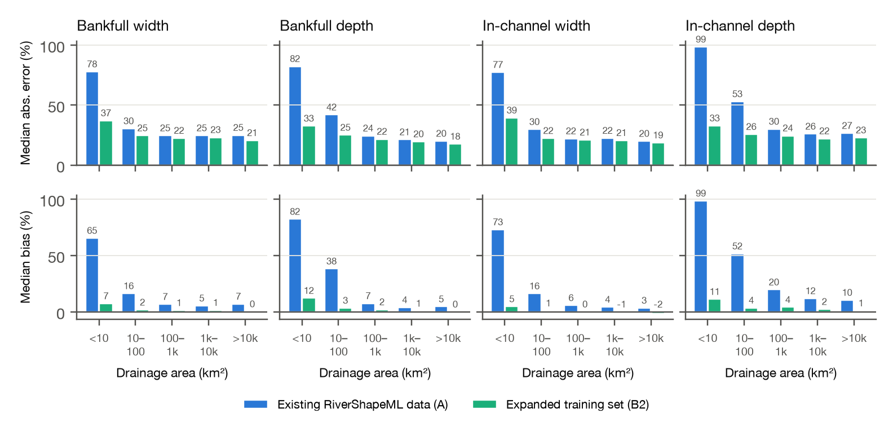
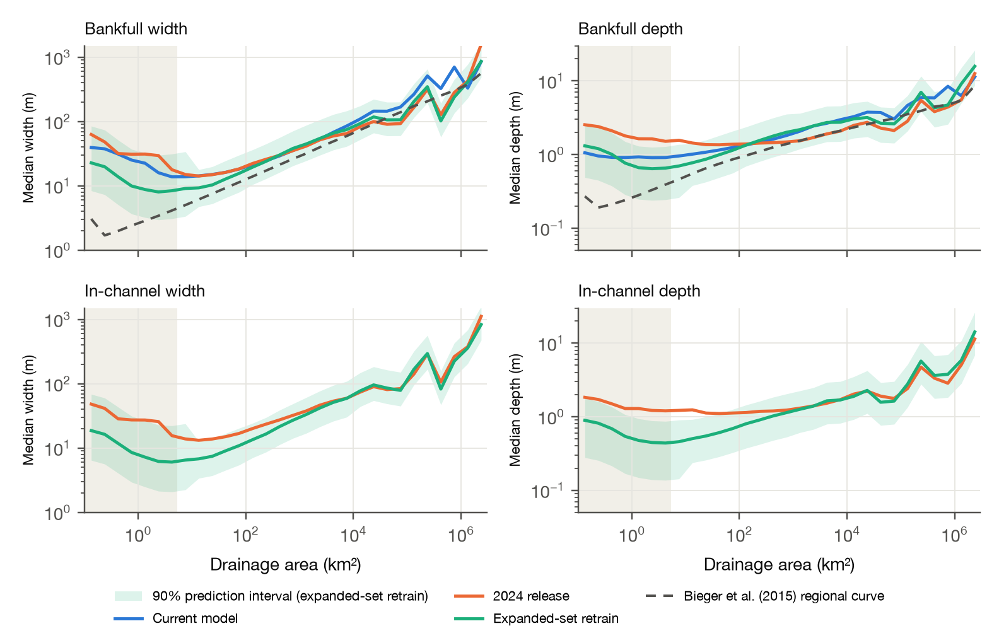

# Adding USGS channel measurements to RiverShapeML

**More USGS measurements cut held-out median error in small streams (under 10 km²) from 78% to 37% for bankfull
width, from 82% to 33% for bankfull depth, and from 99% to 33% for in-channel depth.** Those streams make up 58% of
NHDPlus reaches and have the fewest training sites. The re-predicted national product covers bankfull and in-channel
width and depth, each with a 90% prediction interval.

Independent work, not affiliated with or endorsed by Lynker, NOAA or the RiverShapeML authors.

RiverShapeML predicts bankfull and in-channel width and depth for all ~2.65 million NHDPlus reaches in CONUS, from a model
trained on HYDRoSWOT (USGS acoustic Doppler measurements through 2014). USGS now publishes every channel
measurement it makes, by every method, through its Water Data OGC API (4.77 million records). This repository
rebuilds RiverShapeML's training targets from those records, retrains the model with everything else held
fixed, and re-predicts the national product with 90% prediction intervals.

- **Short memo (3 pages):** [memo/memo_short.pdf](memo/memo_short.pdf)
- **Long form:** [memo/memo_long.pdf](memo/memo_long.pdf)
- **Interactive notebook:** [notebooks/explore.py](notebooks/explore.py) (marimo)
- **Data product:** [v2.0 release](https://github.com/northlinehydrology/rivershapeml-more-data/releases/tag/v2.0): bankfull and in-channel width and depth with 90%
  prediction intervals for all 2,647,454 reaches (`rivershapeml_expanded_set_v2.parquet`), in the column names of the
  2024 HydroShare release. The bankfull-only [v1.0 release](https://github.com/northlinehydrology/rivershapeml-more-data/releases/tag/v1.0) remains available.

Everything uses public data and runs on a laptop.

## Built on RiverShapeML

This work stands on **RiverShapeML** by Arash Modaresi Rad and colleagues (Modaresi Rad et al., 2024,
*JGR: Machine Learning and Computation*; [lynker-spatial/RiverShapeML](https://github.com/lynker-spatial/RiverShapeML)).
It was possible because the model's deployment pipeline, **[NOAA-OWP/predict-riverML](https://github.com/NOAA-OWP/predict-riverML)**,
is public. Its inputs for every reach, derived features and trained models reproduce the deployed bankfull
width and depth exactly: on the same reaches, the published output statistics match to six decimals. Every
experiment here therefore runs on the model's own features and pipeline. Hydraulic-geometry fits use
**[AHGestimation](https://github.com/mikejohnson51/AHGestimation)** by Mike Johnson (NOAA OWP), with
contributions from Arash Modaresi Rad.

This repository is MIT-licensed, except that `src/riverml_pipeline.py` adapts data-loading and inference code from
predict-riverML (Apache-2.0), with model settings changed as described below. RiverShapeML and AHGestimation are MIT.

## Results

**More training sites, especially in small streams.**

| Drainage area (km²) | Published width targets (R² ≥ 0.6) | Expanded training set |
|---|---:|---:|
| < 10 | 66 | 125 |
| 10–100 | 596 | 1,274 |
| 100–1,000 | 1,766 | 2,929 |
| 1,000–10,000 | 1,395 | 2,123 |
| > 10,000 | 485 | 754 |
| **Total** | **4,375** | **7,221** (4,637 existing + 2,584 new sites) |

Bankfull width targets. 58% of NHDPlus reaches drain less than 10 km². Bankfull depth (7,295 sites), in-channel
width (7,040) and in-channel depth (7,275) follow the same pattern.

**The added measurements are consistent with HYDRoSWOT.** Across 3,634 existing sites, bankfull width
targets from all measurements and from HYDRoSWOT alone agree at the median (ratio 0.997). For depth, where the
same kind of deployment appears in both, depths agree within 0.1–2.4%: bridge +0.1%, boat +2.4%,
cableway +1.0%.

**Lower held-out error, coming from the new sites.** The same model was trained on the existing RiverShapeML
data (**A**: existing sites, HYDRoSWOT-only targets) and on the expanded training set (**B2**), for each of the
four quantities. Both were scored on the same held-out sites with 5-fold cross-validation grouped by reach,
repeated with 3 seeds.



| A → B2 | Bankfull width | Bankfull depth | In-channel width | In-channel depth |
|---|---|---|---|---|
| Median absolute error, all sites | 25.9% → 22.9% | 24.9% → 21.2% | 23.5% → 21.0% | 31.2% → 23.8% |
| Median absolute error, < 10 km² | 78% → 37% | 82% → 33% | 77% → 39% | 99% → 33% |
| Median bias, < 10 km² | +65% → +7% | +82% → +12% | +73% → +5% | +99% → +11% |
| Median absolute error, sites new to training | 32% → 26% | 42% → 25% | 32% → 25% | 56% → 28% |
| Log R², all sites | 0.76 → 0.82 | 0.65 → 0.78 | 0.74 → 0.83 | 0.53 → 0.76 |
| Existing sites, scored on HYDRoSWOT-only targets | 20.5% → 20.1% | 18.4% → 18.4% | 17.9% → 17.5% | 20.9% → 20.7% |

At existing sites, judged on the original target definition, the two models match. The improvement comes
from the new sites, and is largest for in-channel depth, where the added wading measurements are densest.

**A re-predicted national product.** Every reach gets bankfull and in-channel width and depth with
split-conformal 90% prediction intervals by drainage-area class, with coverage of 0.88–0.90 on held-out sites
for all four. For bankfull, between 100 and 10,000 km² the product agrees with the current model within about
10%. In headwaters it is narrower and closer to the Bieger et al. (2015) regional curves:



| Bankfull check (all reaches) | Expanded-set retrain | Current model | 2024 release |
|---|---:|---:|---:|
| Median width | 10.7 m | 18.4 m | 23.4 m |
| Width > 1 km | 0.002% | 0.47% | 0.013% |
| Width–drainage-area exponent (Bieger: 0.36) | 0.23 | 0.15 | 0.06 |
| Median ratio to Bieger width | 1.74 | 2.88 | 3.28 |

**In-channel.** The current deployed model is bankfull only, so in-channel is compared with the 2024 release.
Above about 1,000 km² the two agree; in small streams the retrain is much smaller (median in-channel width under
10 km² 7.0 m against 22.6 m). The retrain's in-channel width is 75% of its bankfull width at the median (2024
release: 92%), and its in-channel depth 67% of bankfull depth (2024 release: 81%). The in-channel flow here is
the smallest annual peak since water year 2000 (the 1-year flood), so differences from the 2024 release mix
data and definition. Where an in-channel prediction came out above bankfull it is capped at bankfull (6.8% of
reaches for width, 1.3% for depth).

## Names used here

| Name | Definition |
|:--|:--|
| **Expanded training set** | RiverShapeML's training gages plus additional USGS gages, with targets built from all USGS channel measurements since 2000 (every measurement method, not only ADCP) |
| **Current model** | RiverShapeML as deployed by NOAA OWP ([NOAA-OWP/predict-riverML](https://github.com/NOAA-OWP/predict-riverML)), run on its published inputs |
| **2024 release** | RiverShapeML outputs published on HydroShare in 2024 (an earlier model generation) |
| **Expanded-set retrain** | the current model's features and pipeline, retrained on the expanded training set |
| **ML-derived channel width and depth, expanded-set retrain** | the expanded-set retrain's predictions: bankfull and in-channel width and depth with 90% prediction intervals for every reach ("ML-derived channel width and depth" is the RiverShapeML product's published name) |
| **Bieger regional curve** | Bieger et al. (2015) field-based regional equations for bankfull width and depth, applied per reach by USGS |
| **A / B1 / B2** | training runs: existing sites with HYDRoSWOT-only targets / existing sites with all-measurement targets / B1 plus new sites |

## Process


**Data lineage.** [docs/data_lineage.md](docs/data_lineage.md) lists every table in the pipeline, with
its source, query, version, download date and the operations that connect them. It is generated from
[docs/data_lineage.yaml](docs/data_lineage.yaml), and `python src/data_lineage.py` checks the spec against
the code and the files on every run (36 tables, 18 operations).

### Method in brief

1. **Measurements.** All USGS channel measurements come from the Water Data OGC API: `channel-measurements`,
   `monitoring-locations`, `time-series-metadata` and `peaks`. Gages are linked to NHDPlus reaches with the
   NLDI, and existing RiverShapeML sites keep their published COMIDs. New candidate sites are CONUS gages with
   ≥ 5 measurements since 2000 and ≥ 10 years of daily flow: 4,501 sites, of which 4,317 link to a reach.
2. **Targets.** Measurements are converted to SI and screened with RiverShapeML's sanity rules (width < 4 km,
   depth < 65 m, Q ≤ 1.1 × maximum annual peak). Width, depth and velocity are fit against flow with
   AHGestimation (`mad_filter` → `qva_filter` → `ahg_estimate`). Each curve is read at two flows from the
   site's annual peaks since water year 2000 (peaks flagged as below/above a reported value or as a dam failure
   are dropped; one peak per water year; ≥ 10 peaks): **bankfull** at the 2-year flood, Q₂ (the median annual
   peak), and **in-channel** at the 1-year flood, Q_in (the smallest annual peak). Sites where depth falls as
   flow rises are dropped (48 sites), and an in-channel target is kept only where it is below bankfull.
   - **Precision filter.** RiverShapeML's R² ≥ 0.6 filter is replaced by a precision filter: standard error
     of the log target ≤ 0.2, the target flow no more than 3 × beyond the measured flow range at either end,
     and n ≥ 5.
   - **HYDRoSWOT-only targets** (run A) use the HYDRoSWOT records themselves for width. HYDRoSWOT records
     only maximum depth, so for depth they use the USGS records of the same visits (97% match by date and
     discharge).
3. **Model.** The 30 deployment features, feature engineering and inference come from predict-riverML. The
   XGBoost settings keep the deployed learning rate and sampling, with tree depth, minimum child weight and
   tree count chosen by a regularization sweep with early stopping on a reach-grouped 70/15/15 split (depth 6,
   min_child_weight 5, about 2,450 trees). These settings match the deployed settings' held-out accuracy with
   about a quarter of the trees. The in-channel models use the same settings as their bankfull counterparts,
   and all runs use the same settings.
4. **Evaluation.** Error is ln(predicted / observed), summarized as:
   - **Median absolute error:** median |pred − obs| / obs.
   - **Bias:** median(pred / obs) − 1.
   - **Within 2×:** share of sites with 0.5 ≤ pred/obs ≤ 2.
   - **Log R²:** in natural log of meters.

   Metrics are averaged over seeds.
5. **Product.** The B2 models are refit on all sites and applied to every reach through the deployment pipeline,
   with in-channel capped at bankfull.
   Split-conformal 90% intervals are calibrated per drainage-area class on out-of-fold residuals, and coverage
   is checked on sites unseen by both the model and the calibration.

### Known limitations and simplifications

- **Split-flow measurements.** Where USGS records a split-flow measurement as one row per channel, the rows
  are treated as separate points, as in HYDRoSWOT and RiverShapeML. This affects a minority of sites (about 9%
  had more than 10% of rows split in the v1.0 target set).
- **Regulated peaks.** Regulated peaks are kept in the peak series used for Q₂ and Q_in.
- **Cross-validation grouping.** Cross-validation holds out whole reaches, not whole basins, so neighbouring
  gages on one river can fall on either side of a split. A basin-blocked check is a natural next robustness test.
- **Accuracy is measured at gages.** Gaged reaches skew larger and more modified than typical headwaters.
  Below 10 km² the intervals rest on about 125 calibration sites and should be read as indicative.
- **Headwater sampling is still thin.** Below 5 km² there are about 55 training sites for 1.16 million reaches,
  and tree ensembles flatten rather than extrapolate there.
- **Small gaps in the inputs.** 184 candidate gages did not link to a reach through the NLDI. During the
  national download, 14 bad-record skips stepped past a handful of records the USGS API failed to serve.

## Reproduce

```bash
python3 -m venv .venv && source .venv/bin/activate
pip install -r requirements.txt
./setup_r.sh             # R packages for AHGestimation (R >= 4.2; commit pinned in r_ahg_commit.txt)
echo "YOUR_KEY" > .env   # free key: https://api.waterdata.usgs.gov/signup/ (needed for the ~1 hr USGS download)
./get_data.sh            # RiverShapeML @29c1209, predict-riverML @3430296, HydroShare, USGS, E2NHDPlus, Bieger
./run_all.sh             # targets, data checks, tuning, retrains, product, lineage check
marimo run notebooks/explore.py   # explore the results
python memo/make_figures.py && python memo/build_pdf.py memo/memo_short.md   # memo figures and PDF
```

Data and outputs go to `data/`, which is not tracked. `run_all.sh` regenerates the re-predicted product and its
release file (`data/derived/release/rivershapeml_expanded_set_v2.parquet`, published with the [v2.0 release](https://github.com/northlinehydrology/rivershapeml-more-data/releases/tag/v2.0)).

## Layout

| Path | What it does |
|---|---|
| `src/fetch_usgs_ogc.py` | Pages through national USGS OGC API collections (resumable, handles bad records) |
| `src/keys.py` | Reads the API key from `.env` or `API_USGS_PAT` |
| `src/new_rows.py`, `src/site_comids.py` | Candidate sites and gage-to-reach links (NLDI) |
| `src/build_targets.py`, `src/ahg_fit.R` | Measurements → AHGestimation fits → bankfull and in-channel targets at Q₂ and Q_in |
| `src/method_agreement.py`, `src/noise_floor.py`, `src/depth_gap.py`, `src/silverway.py`, `src/target_flows.py` | Data checks |
| `src/riverml_pipeline.py` | The predict-riverML deployment pipeline, reproduced for reuse; model settings |
| `src/tune_regularization.py`, `src/train_eval.py` | Regularization sweep and train/validation/test diagnostics |
| `src/retrain_riverml.py`, `src/metrics.py` | A / B1 / B2 runs and error metrics |
| `src/predict_baseline.py`, `src/predict_product.py`, `src/build_product_compare.py`, `src/export_product.py` | Current model, expanded-set retrain with intervals, product comparison, release file |
| `src/data_lineage.py`, `docs/` | Data lineage spec, generated docs and process diagram |
| `notebooks/explore.py` | marimo notebook: lineage, sites, targets, runs and the national product |
| `memo/` | Memos, figures and the PDF builder; `next_steps.md` lists follow-ups |

## Sources

- Modaresi Rad, A., et al. (2024). *JGR: Machine Learning and Computation*. doi:10.1029/2024JH000173.
  Code: [lynker-spatial/RiverShapeML](https://github.com/lynker-spatial/RiverShapeML). Deployment:
  [NOAA-OWP/predict-riverML](https://github.com/NOAA-OWP/predict-riverML). 2024 outputs: HydroShare,
  doi:10.4211/hs.d147fcf554a54b2aaa4f146f85da0e03.
- Johnson, J. M., et al. AHGestimation. [github.com/mikejohnson51/AHGestimation](https://github.com/mikejohnson51/AHGestimation).
- Canova, M. G., Fulton, J. W., and Bjerklie, D. M. (2016). USGS HYDRoSWOT. doi:10.5066/F7D798H6.
- Bieger, K., et al. (2015). *JAWRA* 51(3), 842–858. doi:10.1111/jawr.12282. Data: doi:10.5066/F7765D7V.
- USGS Water Data APIs ([api.waterdata.usgs.gov](https://api.waterdata.usgs.gov)); NLDI; E2NHDPlusV2 attributes
  (USGS ScienceBase 63cb311ed34e06fef14f40a3).
- Lei, J., et al. (2018). Distribution-free predictive inference for regression. *JASA* 113(523), 1094–1111.
