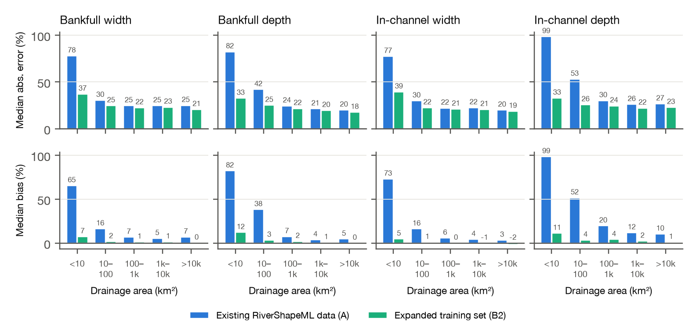
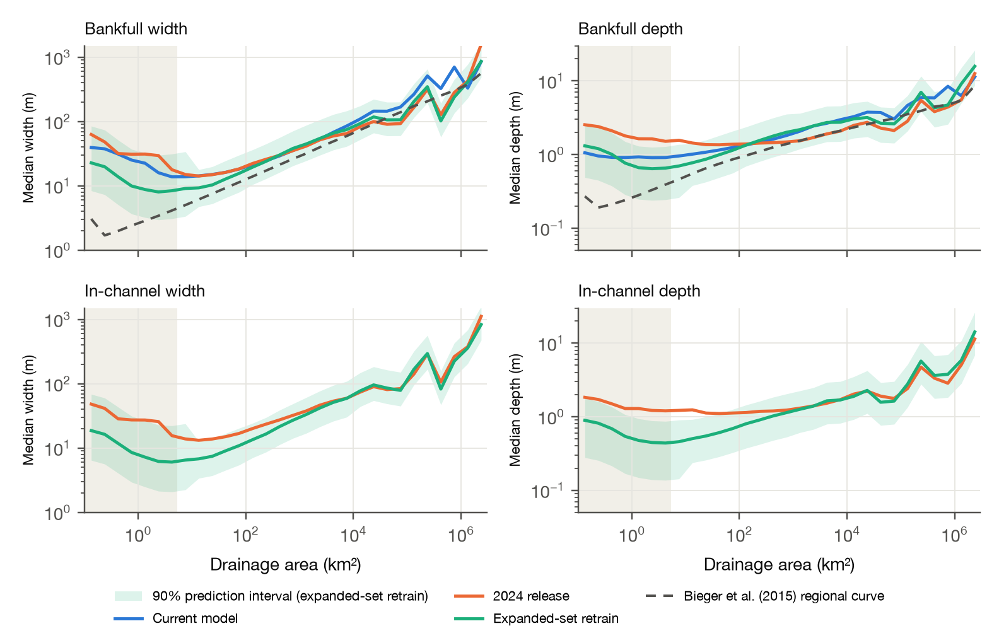

# Adding USGS channel measurements to RiverShapeML

*Andrew Sommerlot · andrewsommerlot@gmail.com · November 2026*

RiverShapeML (Modaresi Rad et al., 2024) predicts bankfull and in-channel width and depth for all 2.65
million NHDPlus reaches in CONUS from a model trained on HYDRoSWOT, the USGS collection of acoustic Doppler
(ADCP) measurements through 2014. USGS now publishes every channel measurement it makes, by every method
(wading, bridge, cableway, boat), through its Water Data OGC API: 4.77 million records. This note asks
whether those measurements improve the model.

**How it started.** The USGS gage on Shoal Creek at Silverway Drive in Austin (08156675), at the end of a
reach I walked, has 68 width measurements. HYDRoSWOT has 2, both from 2009, so the site falls below the
5-measurement minimum and is not used. The other 66, mostly wading measurements, are simply outside HYDRoSWOT.
Across CONUS, that pattern turns out to be common, and most common in small streams.

**What I did.** I rebuilt the training targets from all USGS measurements, using RiverShapeML's sanity rules
and Mike Johnson's AHGestimation for the hydraulic-geometry fits. Each site's curves are read at two flows from
its annual peaks since water year 2000: bankfull at the 2-year flood (the median annual peak) and in-channel
at the 1-year flood (the smallest annual peak). I replaced the R² ≥ 0.6 site filter with a filter on the
precision of the target itself (many well-measured sites have nearly constant width and fail R² for that
reason alone). The features, feature engineering and inference are those of the public
NOAA-OWP/predict-riverML pipeline, whose national outputs I could reproduce exactly from the published
models; the model is the same XGBoost setup with modest regularization and early stopping.

**More sites, especially in small streams.** Bankfull-width training sites rise from 4,375 to 7,221 (+65%).
Sites draining under 10 km² rise from 66 to 125, and 10–100 km² from 596 to 1,274; 58% of NHDPlus reaches
are under 10 km². In-channel targets follow the same pattern (7,040 sites for width). At the same sites,
bankfull widths from all measurements and from HYDRoSWOT alone agree at the median (ratio 1.00), and depths
measured the same way agree within 0.1–2.4%.

**Lower error in every size class, most in small streams and in in-channel depth.** I trained the same model
twice for each of the four quantities: on the existing RiverShapeML data (HYDRoSWOT measurements at existing
sites) and on the expanded set (all measurements, existing and new sites), and scored both on the same
held-out sites with cross-validation grouped by reach.

<figure><figcaption><em>Figure 1. Held-out median absolute error and median bias by drainage area, existing RiverShapeML data (A)
vs the expanded training set (B2), for bankfull and in-channel width and depth.</em></figcaption></figure>

| Median absolute error, A → B2 | Bankfull width | Bankfull depth | In-channel width | In-channel depth |
|---|---|---|---|---|
| All sites | 25.9% → 22.9% | 24.9% → 21.2% | 23.5% → 21.0% | 31.2% → 23.8% |
| < 10 km² | 78% → 37% | 82% → 33% | 77% → 39% | 99% → 33% |
| Median bias, < 10 km² | +65% → +7% | +82% → +12% | +73% → +5% | +99% → +11% |
| Sites new to training | 32% → 26% | 42% → 25% | 32% → 25% | 56% → 28% |
| Existing sites, HYDRoSWOT-only targets | 20.5% → 20.1% | 18.4% → 18.4% | 17.9% → 17.5% | 20.9% → 20.7% |

The existing-data model overpredicts small streams because it has few to learn from, and the effect is
largest for in-channel depth, where the added wading measurements are densest. The gain comes from the new
sites: at existing sites, judged on the original HYDRoSWOT targets, the two models match.

**A re-predicted national product.** I ran the retrained models through the predict-riverML pipeline for
every reach, with split-conformal 90% prediction intervals by drainage-area class (coverage 0.88–0.90 on
held-out sites for all four quantities). For bankfull, between 100 and 10,000 km² it agrees with the current
model within about 10%. In headwaters it is narrower and closer to the Bieger et al. (2015) regional curves,
so the national median width falls from 18.4 m to 10.7 m. Implausibly wide reaches (> 1 km) drop from 0.47%
to 0.002%. In-channel width is 75% of bankfull width at the median, and in-channel depth 67% of bankfull
depth. Above about 1,000 km² the in-channel values agree with the 2024 release; in small streams they are
much smaller (median width under 10 km² 7.0 m against 22.6 m), partly because the in-channel flow is defined
here as the smallest annual peak since 2000.

<figure><figcaption><em>Figure 2. Median bankfull (top) and in-channel (bottom) width and depth by drainage area, all CONUS
reaches. The current model has no in-channel output and the regional curves are bankfull only. The shaded
region holds 44% of reaches but only ~55 training sites; the gap to the regional curves narrows but does not
close.</em></figcaption></figure>

**Questions and discussion.**

1. What was the original motivation for training on HYDRoSWOT, for example a single, consistent
   measurement method? The agreement above suggests data from other methods could be added.
2. About 7,000 more sites, mostly small streams, have enough measurements but short flow records.
   RiverShapeML's existing NWM flood-frequency option could be used to bring them in.
3. Which in-channel flow do downstream users, such as flood mapping, need? The added measurements change
   in-channel geometry most, so the definition matters most there.

**Credit and citations.** This builds directly on Arash Modaresi Rad's RiverShapeML and the NOAA Office of
Water Prediction's open predict-riverML pipeline, whose published models and inference code made a
controlled comparison possible, and on AHGestimation by Mike Johnson, with contributions from Arash Modaresi
Rad. The code (one script rebuilds everything from public sources), a longer write-up and an interactive
notebook are at [github.com/northlinehydrology/rivershapeml-more-data](https://github.com/northlinehydrology/rivershapeml-more-data); the re-predicted product, bankfull and in-channel width and depth with intervals for every reach, is in the
[v2.0 release](https://github.com/northlinehydrology/rivershapeml-more-data/releases/tag/v2.0).

<em>References.</em> Modaresi Rad, A., et al. (2024),
<em>JGR: Machine Learning and Computation</em>, doi:10.1029/2024JH000173. Bieger, K., et al. (2015), <em>JAWRA</em>
51(3), 842–858, doi:10.1111/jawr.12282. Johnson, J. M., et al., AHGestimation (R package).

